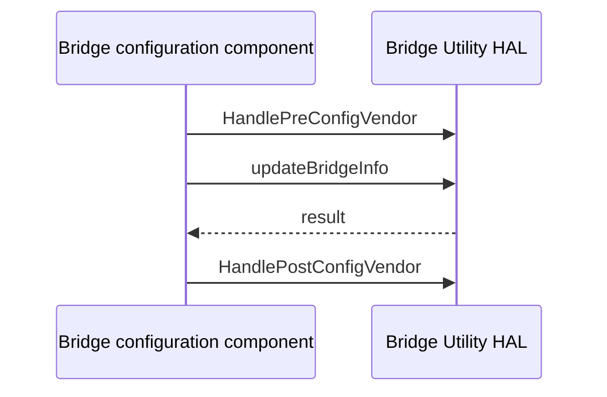

# Bridge Utility HAL Specification

## Version History

| Date | Comment | Version |
| --- | --- | --- |
| — | Documentation alignment; no ABI change. | — |

## Acronyms
HAL means Hardware Abstraction Layer; RDK-B means Reference Design Kit for Broadband; OEM means Original Equipment Manufacturer.

## Description
The bridge configuration component uses this HAL's vendor hooks and interface-list helpers to configure bridges.

## Optional Components
Platform-specific bridge membership and vendor interface discovery belong to the implementation. Do not assume a particular bridge backend.

## Component Runtime Execution Requirements
### Initialization and Startup
For a bridge configuration transaction, invoke `HandlePreConfigVendor`, update the bridge through `updateBridgeInfo`, and invoke `HandlePostConfigVendor` as appropriate to the operation.
### Threading Model
Serialize calls involving shared bridge configuration and globals.
### Process Model
The interface is a library boundary, not an IPC protocol. Coordinate concurrent bridge writers across processes.
### Memory Model
Callers own supplied structures and interface lists unless the individual declaration states otherwise. Confirm the vendor ownership contract before freeing or retaining the pointer returned by `getVendorIfaces`.
### Internal Error Handling
Check each function's declared return value; `removeIfaceFromList` returns `void` and must not be tested as a status-returning operation.
### Persistence Model
Persistence and rollback are platform responsibilities; successful in-memory list changes do not establish durable bridge configuration.

## Nonfunctional Requirements
### Logging and Debugging
Implementations must not log credentials, secrets, security-sensitive information, or other sensitive data. Log operation outcomes rather than payloads.
### Quality Control
Compile with warnings enabled and run static analysis and memory checks. Test missing interfaces and repeated configuration.
### Licensing
See the repository's Apache-2.0 license notices.
### Build Requirements
Compile against both public headers and link the vendor implementation selected by the product recipe.
### Variability Management
Treat vendor hooks and interface-list limits in the headers as platform contract boundaries.

## Interface API Documentation
The linked headers contain signatures, argument descriptions, and return contracts for every public operation:
- `updateBridgeInfo`: update bridge information.
- `checkIfExists`: inspect interface-list membership.
- `removeIfaceFromList`: remove a list entry; no return status.
- `checkIfExistsInBridge`: inspect bridge membership.
- `HandlePreConfigVendor` and `HandlePostConfigVendor`: vendor transaction hooks.
- `getVendorIfaces`: obtain vendor interface information.

### Theory of Operation and Key Concepts
List inspection does not itself apply kernel configuration. Preserve vendor hook ordering and inspect failure before continuing dependent steps.

### Sequence Diagram

## Source References
- [bridge_util_hal.h](https://github.com/rdkcentral/rdkb-halif-bridge-util/blob/develop/include/bridge_util_hal.h)
- [network_interface.h](https://github.com/rdkcentral/rdkb-halif-bridge-util/blob/develop/include/network_interface.h)
